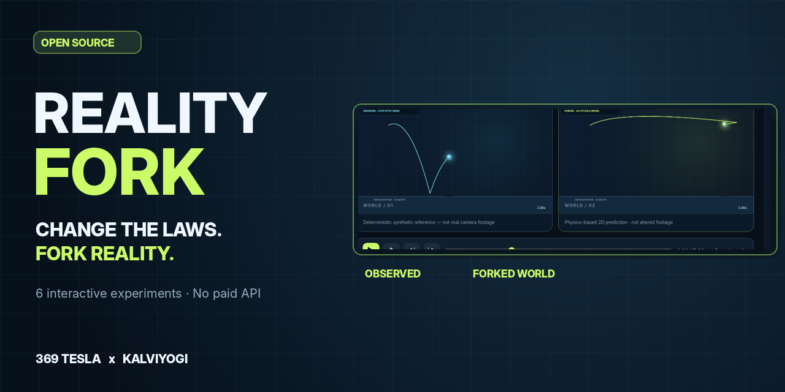
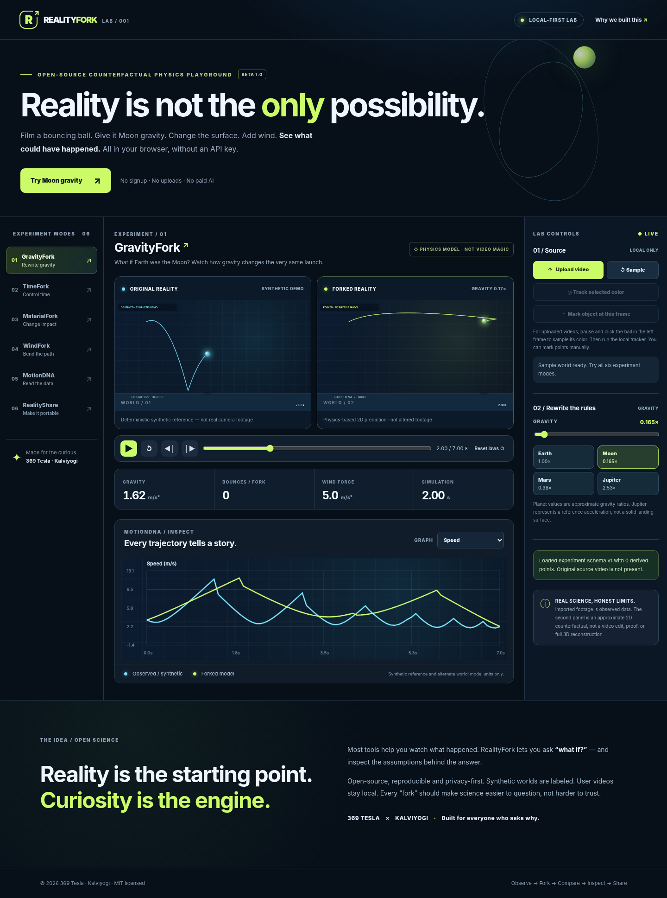

<div align="center">

# REALITYFORK

### Change the laws. Fork reality.

**A local-first browser lab for counterfactual motion experiments.**

[](LICENSE)  [](https://github.com/369teslaNaga/realityfork/actions/workflows/ci.yml) 

### [▶ Try the Live Interactive Demo](https://369teslanaga.github.io/realityfork/) · [Watch the 15-second Demo](assets/realityfork-launch-teaser.mp4) · [View the Code](https://github.com/369teslaNaga/realityfork)

**Observe → Fork → Compare → Inspect → Share**

Created by **369 Tesla · Kalviyogi** · Open source · No account · No user-video uploads



</div>

## Try it in 30 seconds — no installation

1. **[Open RealityFork](https://369teslanaga.github.io/realityfork/)** and click **Try Moon gravity**. The side-by-side trajectories are based on a **synthetic sample**.
2. Open **MaterialFork** and select **Rubber**, or open **WindFork** and move the wind slider. See how the model changes.
3. Open **RealityShare** to export a PNG experiment card, then show someone the two worlds.

Want to test motion from your own footage? Upload a **short, high-contrast ball video** inside the browser. Tracking is experimental, and footage is not sent to a server. See the [steps below](#bring-your-own-video-experimental).

**[↗ Live lab](https://369teslanaga.github.io/realityfork/)** · **[▶ 15-second synthetic demo](assets/realityfork-launch-teaser.mp4)** · **[How it works](docs/SCIENCE.md)** · **[Contribute](CONTRIBUTING.md)**

## The 10-second idea

What if that ball you dropped on Earth bounced on the Moon? **RealityFork** lets you watch a synthetic motion example immediately or inspect a short video of your own, modify a simple 2D physics model and compare the results side by side. It's a creative *what-if lab*, not a claim that we can reconstruct a complete physical world from an arbitrary video.

### Try it

**Node.js 20+**, no dependency installation:

```bash
npm run dev
```

Open **http://127.0.0.1:5173**. Alternatively, serve the directory with any static HTTP server. No API keys, CDN scripts, account or database are required. The public GitHub Pages deployment uses [`.github/workflows/static.yml`](.github/workflows/static.yml).

> Start on the **synthetic sample**. Click *Try Moon gravity*, choose *Rubber* in MaterialFork, experiment with wind, pause/step in TimeFork and export a card in RealityShare.



## Six experiences, actually usable

| Mode | Available in this beta | Honest boundaries |
|---|---|---|
| **01 GravityFork** | Earth, Moon, Mars, Jupiter ratios + custom gravity; side-by-side deterministic path | Reference accelerations only, no planet terrain or true 3D |
| **02 TimeFork** | 0.1–5× speed, pause, frame step, time scrub, reset | Playback speed doesn't alter physics |
| **03 MaterialFork** | Restitution 0–1, rubber/wood/concrete/foam example pairs, changing bounce heights | Example coefficients, **not** measured material constants |
| **04 WindFork** | Signed horizontal acceleration; linear drag; trajectories change in real time | Simplified force approximation, no CFD / fluid flow |
| **05 MotionDNA** | Position/speed/acceleration chart; local RGB object tracking; per-frame manual marks; optional pixels-per-metre reference; observed CSV | Prototype, high-contrast ball only; camera perspective and poor tracking can give wrong values |
| **06 RealityShare** | 1600×940 branded PNG; 5-sec local WebM when browser supports it; versioned JSON import/export; settings-only URL; CSV | Video export replays **derived trajectory**, not edited source frames. Share URLs don't contain video or observations |

### Bring your own video (experimental)

1. Use a **short, steady MP4 or WebM** (under 175 MB) with a colored ball against a contrasting background.
2. Press **Upload video**. Your chosen file stays on your device.
3. Pause on a clear frame, then **click the ball** inside the **left canvas** to sample its RGB color.
4. Choose **Track selected color** (48 local frame samples, up to seven seconds), or use **Mark object at this frame** while stepping manually.
5. Go to MotionDNA to inspect positions/velocities. Input known **pixels per metre** only if the scene has a suitable reference measurement; otherwise the observed data is in normalized frame units.
6. Change Gravity/Material/Wind on the forked model. Export a Reality Card, a CSV of measured positions, or a versioned experiment JSON.

For a self-contained test, use [`assets/synthetic-ball-test.webm`](assets/synthetic-ball-test.webm). This is generated footage, not a real-world validation set.

## Architecture

```text
index.html + styles.css                  static international UI
src/main.js                              app controller + six experiments
src/engine.js                            deterministic fixed-step physics
src/analysis.js                          observed track + finite differences
src/tracker.js                           local RGB video frame tracker
src/render.js                            two worlds, charts, PNG/WebM visuals
src/io.js                                schema-v1 JSON, CSV, URL sharing
tests/*.test.mjs                         zero-dependency automated unit tests
tests/browser_smoke.py                   optional Chromium integration tests
.github/workflows/                      CI + opt-in GitHub Pages deployment
docs/                                    ideology, scientific limits, release kit
```

Built with **HTML, CSS, vanilla JavaScript ES modules and Canvas 2D**. No frameworks, paid services, backend, surveillance, accounts or external model downloads are required. The optional Node server is for local development only; published pages are static.

## Validation

```bash
npm run check
npm test
```

20 Node automated tests cover determinism, bounce collisions, gravity, wind, drag, source tracking, motion-unit conversion and JSON/CSV round trips.

Optional Chromium integration script: `python tests/browser_smoke.py` (requires Python Playwright and a local Chromium binary). The script intentionally exercises the app with **local inline module bundling** because some sandbox environments block any browser URL navigation; it does **not** replace a smoke test of the deployed GitHub Pages site. The release author should test the public URL, browser codec support and mobile touch input separately.

## The five RealityFork principles

1. **See the assumption.** Every simulation must distinguish observed motion from predicted motion.
2. **Fork the variable.** Change one rule and make the resulting difference visible.
3. **Prove nothing you haven't measured.** Synthetic demonstrations and uncalibrated tracks never imply real-world accuracy.
4. **Keep the source local.** No user video, private observation or tracking data is transmitted by our code.
5. **Give the experiment away.** Portable settings, derived data, open code and testable algorithms.

Read [IDEOLOGY.md](docs/IDEOLOGY.md), [SCIENCE.md](docs/SCIENCE.md), [PRIVACY.md](docs/PRIVACY.md), and the [Tamil launch guide](docs/TAMIL_RELEASE_GUIDE.md).

## Current limitations and road map

This is a public **experimental beta**, not a commercially validated physics reconstruction engine. RGB color tracking can confuse similar-colored objects, perspective distortion breaks real-world scale, 2D acceleration isn't recovered reliably from a single video and a universal object tracker is **not** included. In some browsers WebM export may be unavailable. Video frames themselves are never hosted. See [FEATURE_STATUS.md](docs/FEATURE_STATUS.md) and [ROADMAP.md](docs/ROADMAP.md) for precise boundaries and planned research.

## Contribute

Issues, source improvements, open-license test clips and numerical physics tests are welcome. Please read [CONTRIBUTING.md](CONTRIBUTING.md) and [CODE_OF_CONDUCT.md](CODE_OF_CONDUCT.md); do not include private video data in public reports. If you discover a vulnerability, consult [SECURITY.md](SECURITY.md).

## Share the experiment

If this made you curious, **try one experiment and share the result** rather than sharing only the repository link. The best intro is a 10-second side-by-side comparison: *Earth vs. Moon gravity*. Use the [launch media and copy](docs/LAUNCH_COPY.md); see the [public launch playbook](docs/LAUNCH_CAMPAIGN.md) for ethical distribution and ways to improve the project from real feedback.

## Launch-ready assets

- [`assets/social-preview.png`](assets/social-preview.png): 1280×640 repository social media image.
- [`assets/realityfork-launch-teaser.mp4`](assets/realityfork-launch-teaser.mp4): 15-second promotional clip **clearly labeled synthetic**.
- [Launch copy for X, LinkedIn, Hacker News and Tamil](docs/LAUNCH_COPY.md).
- [Exactly how to publish and turn on GitHub Pages](docs/PUBLIC_RELEASE.md).

## License and credits

MIT License. © 2026 369 Tesla / Kalviyogi and contributors. The app uses Web APIs and a small original 2D physics model; it does **not** depend on or bundle third-party proprietary model weights.

---

<div align="center"><strong>REALITY IS THE STARTING POINT. CURIOSITY IS THE ENGINE.</strong><br>By 369 Tesla · Kalviyogi</div>
