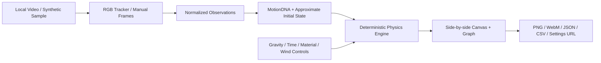

# Architecture

A zero-dependency static ES-module web application. It can be served by GitHub Pages and used on desktop/mobile browsers. Node.js is used only for the local dev server and CI tests.

`src/engine.js`: deterministic, fixed-step model and source baseline. No DOM and no network.

`src/tracker.js`: local HTMLVideoElement frame seeking and color segmentation; cancellation; excludes external ML models. Requires a DOM to run.

`src/analysis.js`: sanitizes `[t,x,y]` observations in normalized frame coordinates, measures finite-difference motion; estimates an illustrative initial condition and tracking coverage.

`src/render.js`: renders two worlds and trajectory graphs on Canvas, creates branded PNG cards and a 5-second derived-data reel. Distinguishes synthetic, observed and modeled data.

`src/io.js`: strictly versioned JSON (schema v1), CSV exports, URL encoding. No raw video in exports. Settings-only URL hashes intentionally exclude observed positions; JSON export contains derived observation coordinates **only after the user clicks Export**.

`src/main.js`: browser state, modes, events, data origin labels, video state, sharing and safe input handling.

## Threat model / no user video uploads

The app contains no `fetch`, `XMLHttpRequest`, analytics SDK, remote model requests or API endpoints. All video processing uses a local File object with a browser `blob:` object URL, revoked when replaced/unloaded. User-requested exports can be saved/shared by the user and should be treated as potentially sensitive files.

## Future contribution interfaces

- Plug-in trackers returning sorted normalized `{t,x,y,manual}` observations with quality signals.
- Physically characterized model solvers with numerically tested units.
- Portable, documented v2 schema with migration support.
- Experiment fixture format with permission-cleared source media and ground truth.

These are architecture directions, **not features shipped in beta**.
